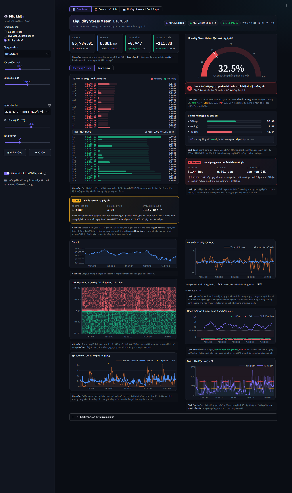
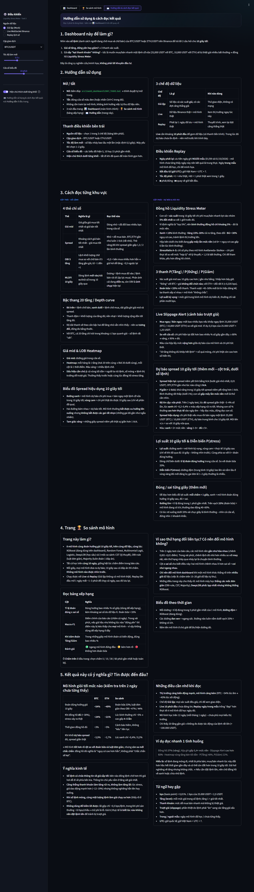
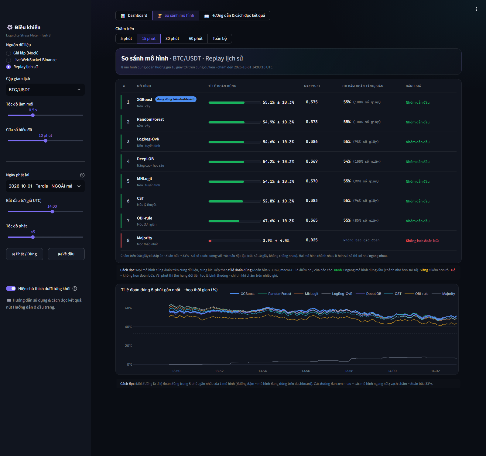

# Liquidity Stress Meter – Dự báo sổ lệnh & rủi ro thanh khoản crypto

> Đề tài: **Limit Order Book & Liquidity Stress Prediction** (Research Blueprint 05 – Crypto Finance Lab, ô số 5).
> Thị trường: **BTC/USDT** và **ETH/USDT** trên sàn Binance.
> Đây là sản phẩm học thuật, **không phải khuyến nghị đầu tư**.

Hệ thống đọc **sổ lệnh** (danh sách lệnh chờ mua/bán, 20 mức giá mỗi bên) của Binance mỗi giây. Từ đó nó:

1. Dự báo **giá sẽ Tăng / Đứng / Giảm trong 10 giây tới**.
2. Cảnh báo **căng thẳng thanh khoản** (sắp khó mua bán, dễ bị trượt giá), hiển thị bằng đồng hồ Xanh / Vàng / Đỏ.
3. Dự báo **spread** (chênh lệch giá mua – bán) sẽ giãn ra trong 10 giây tới.
4. **So sánh 8 mô hình** chạy cùng lúc trên cùng dữ liệu: XGBoost, Random Forest, Logistic, DeepLOB…

Tất cả gói trong một **dashboard** mở bằng trình duyệt. Dashboard chạy được với dữ liệu **thật trực tiếp từ Binance**, **phát lại một ngày trong quá khứ**, hoặc **dữ liệu giả lập** (không cần mạng).



---

## Mục lục

1. [Kết quả chính](#1-kết-quả-chính)
2. [Trong thư mục này có gì](#2-trong-thư-mục-này-có-gì)
3. [Cần chuẩn bị gì](#3-cần-chuẩn-bị-gì)
4. [Tải bài về máy](#4-tải-bài-về-máy)
5. [Hướng dẫn chạy – Cách 1: gõ lệnh](#5-hướng-dẫn-chạy--cách-1-gõ-lệnh)
6. [Hướng dẫn chạy – Cách 2: bấm đúp file .bat (dễ nhất)](#6-hướng-dẫn-chạy--cách-2-bấm-đúp-file-bat-dễ-nhất)
7. [Dùng dashboard](#7-dùng-dashboard)
8. [Chạy lại phần nghiên cứu (không bắt buộc)](#8-chạy-lại-phần-nghiên-cứu-không-bắt-buộc)
9. [Lỗi thường gặp](#9-lỗi-thường-gặp)
10. [Tài liệu chi tiết & nguồn dữ liệu](#10-tài-liệu-chi-tiết--nguồn-dữ-liệu)

---

## 1. Kết quả chính

Kiểm tra trên **2 ngày test mô hình chưa từng thấy** (01/09/2026 và 01/10/2026). Mô hình được huấn luyện trên 10 ngày trước đó, chia theo thời gian, không xáo trộn.

| Câu hỏi | BTC/USDT | ETH/USDT | So với |
|---|---|---|---|
| Đoán đúng hướng giá 10 giây tới (macro-F1) | **0,544** | **0,492** | Đoán bừa ≈ 0,33 · luật OBI đơn giản 0,467 / 0,436 |
| Lúc đồng hồ **Đỏ**, căng thẳng thanh khoản xảy ra thật | **24%** | **21%** | Mức bình thường ≈ 5% (gấp 4–5 lần) |
| Lúc dự báo spread **Đỏ**, spread giãn thật | **3,9%** | **2,7%** | Lúc Xanh chỉ 0,4% / 0,2% |
| DeepLOB (học sâu) có hơn XGBoost? | Không (0,536) | Không (0,479) | XGBoost 0,544 / 0,492 |

**Nói thật về ý nghĩa:**
- Mô hình đoán **tốt hơn hẳn đoán bừa** và tốt hơn các luật đơn giản. Kết quả có ý nghĩa thống kê.
- Lãi gộp chỉ khoảng **+0,5 bps mỗi lệnh**, **nhỏ hơn nhiều so với phí giao dịch**. Dự báo 10 giây **không dùng để kiếm lời**, mà để **tránh vào lệnh lúc thanh khoản xấu** (tránh trượt giá).
- Mô hình học sâu DeepLOB **không tốt hơn** XGBoost. Vì vậy dashboard dùng XGBoost (dự báo nhanh, < 5 ms).
- Mô hình kém đi khi thị trường biến động mạnh.

Toàn bộ số liệu nằm trong [outputs/tables/](outputs/tables/), hình nằm trong [outputs/figures/](outputs/figures/). Giải thích chi tiết (câu hỏi nghiên cứu RQ1–RQ5) ở [README_TASK_2.md](src/task2_models/README_TASK_2.md), mục 4.

---

## 2. Trong thư mục này có gì

```
├── README.md                ← file bạn đang đọc
├── 1_CAI_DAT.bat            ← Bước 1: cài đặt (chỉ 1 lần)
├── 2_MO_DASHBOARD.bat       ← Bước 2: mở dashboard
├── 3_KIEM_TRA.bat           ← (tùy chọn) tự kiểm tra toàn bộ code
├── requirements.txt         ← danh sách thư viện Python (đã ghim đúng phiên bản)
├── .streamlit/config.toml   ← giao diện tối của dashboard
│
├── src/                     ← TOÀN BỘ CODE, gồm 3 phần
│   ├── task1_data/          ← Phần 1 – Dữ liệu: tải lịch sử, thu trực tiếp từ Binance, lưu kho
│   ├── task2_models/        ← Phần 2 – Toán & mô hình: đặc trưng OFI/OBI, huấn luyện, đánh giá
│   └── task3_dashboard/     ← Phần 3 – Dashboard Streamlit (có ảnh chụp trong screenshots/)
│
├── models/                  ← mô hình ĐÃ HUẤN LUYỆN SẴN (mở dashboard không cần train lại)
├── outputs/
│   ├── tables/              ← 33 bảng kết quả (.csv, mở bằng Excel)
│   ├── figures/             ← 25 hình (.png) cho báo cáo
│   └── logs/                ← nhật ký lần chạy
├── data/
│   ├── raw/raw_lob_trades.parquet/   ← dữ liệu sổ lệnh gốc: 12 ngày × 2 cặp (+ vài giờ tự thu)
│   ├── raw/<CẶP>/live_capture/       ← dữ liệu tự thu thô từ Binance, mỗi ngày 1 thư mục
│   └── processed/           ← inventory.csv (danh sách ngày), source_log.csv (nguồn gốc từng file)
└── docs/
    ├── de_bai/              ← đề bài gốc + ảnh Roadmap
    └── *.docx               ← đặc tả nhiệm vụ & kế hoạch dự án
```

Lúc làm, bài được chia thành 3 phần (Task 1, 2, 3). Khi chạy thì **không cần quan tâm** chuyện đó: chỉ cần 2 file `1_CAI_DAT.bat` và `2_MO_DASHBOARD.bat`. Mỗi phần có một **biên bản kỹ thuật** riêng (`README_TASK_x.md` trong thư mục của phần đó) cho ai muốn đọc sâu.

---

## 3. Cần chuẩn bị gì

| Cần | Ghi chú |
|---|---|
| **Máy Windows 10 hoặc 11** | Máy Mac/Linux vẫn chạy được, xem [mục 5](#5-hướng-dẫn-chạy--cách-1-gõ-lệnh) (các file `.bat` chỉ dùng trên Windows) |
| **Python 3.13** | Tải ở https://www.python.org/downloads/. Khi cài, **nhớ tick ô "Add python.exe to PATH"** ở màn hình đầu tiên. Đã thử với 3.13; 3.11–3.12 có thể chạy, 3.10 trở xuống **không** chạy |
| **~3 GB ổ đĩa trống** | Thư viện ~1,7 GB (gồm PyTorch và bộ nhớ tạm khi tải) + dữ liệu ~0,4 GB |
| **Internet** | Lần cài đặt đầu tiên (tải thư viện) và chế độ **Live**. Chế độ Replay và Giả lập không cần mạng |
| RAM ≥ 8 GB | Khuyên dùng. Phát lại 1 ngày dữ liệu cần ~1–2 GB RAM |

Không cần tài khoản Binance, không cần API key.

---

## 4. Tải bài về máy

**Cách A – Tải file ZIP (không cần biết Git):**
1. Mở trang GitHub của bài → bấm nút xanh **`<> Code`** → **Download ZIP**.
2. Chuột phải vào file ZIP → **Extract All… (Giải nén tất cả)** vào một thư mục, ví dụ `D:\LiquidityStressMeter`.
3. **Phải giải nén ra trước.** Không chạy file `.bat` khi đang mở bên trong file ZIP.

**Cách B – Dùng Git:**
```bash
git clone <địa-chỉ-repo-GitHub>
```

> Nên để thư mục ở ổ D hoặc ổ có nhiều chỗ trống. Thư viện sẽ được cài vào ngay thư mục bài (`.venv`), không cài vào ổ C.

---

## 5. Hướng dẫn chạy – Cách 1: gõ lệnh

Dành cho người quen dùng cửa sổ lệnh, hoặc dùng máy Mac/Linux. **Nếu không quen gõ lệnh, bỏ qua mục này, xem ngay [Cách 2](#6-hướng-dẫn-chạy--cách-2-bấm-đúp-file-bat-dễ-nhất).**

Mở **PowerShell** hoặc **Command Prompt** ngay trong thư mục bài: vào thư mục bằng File Explorer → bấm vào thanh địa chỉ → gõ `powershell` → Enter. Sau đó gõ lần lượt:

```powershell
# Bước 1 – Cài đặt (chỉ làm 1 lần)
py -3.13 -m venv .venv                                    # tạo môi trường Python riêng trong thư mục bài
.\.venv\Scripts\python.exe -m pip install -r requirements.txt
.\.venv\Scripts\python.exe -m pip install torch==2.14.1 --index-url https://download.pytorch.org/whl/cpu   # tùy chọn, cho DeepLOB

# Bước 2 – Mở dashboard (mỗi lần muốn xem)
.\.venv\Scripts\python.exe -m streamlit run src/task3_dashboard/app.py --server.headless true
#   → mở trình duyệt vào  http://localhost:8501
#   → tắt: bấm Ctrl+C trong cửa sổ lệnh
```

> Nếu lệnh `py` không có, thay `py -3.13` bằng `python`.

**Máy Mac / Linux:**
```bash
python3.13 -m venv .venv
.venv/bin/python -m pip install -r requirements.txt
.venv/bin/python -m pip install torch==2.14.1 --index-url https://download.pytorch.org/whl/cpu   # tùy chọn
.venv/bin/python -m streamlit run src/task3_dashboard/app.py --server.headless true
```

**Các lệnh khác (tùy chọn):**

| Việc | Lệnh (Windows; Mac/Linux thay `.\.venv\Scripts\python.exe` bằng `.venv/bin/python`) |
|---|---|
| Tự kiểm tra phần dữ liệu (34 mục) | `.\.venv\Scripts\python.exe -m src.task1_data.tools.selftest` |
| Tự kiểm tra phần mô hình (10 mục) | `.\.venv\Scripts\python.exe -m src.task2_models.selftest` |
| Tự kiểm tra dashboard (11 mục, `--live` cần mạng) | `.\.venv\Scripts\python.exe -m src.task3_dashboard.selftest --live` |
| Mở thẳng một chế độ | `http://localhost:8501/?source=replay` · `?source=live` · `?source=mock` |
| Thử kết nối Binance 30 giây | `.\.venv\Scripts\python.exe -m src.task1_data.websocket_streamer --seconds 30` |
| Chạy lại toàn bộ nghiên cứu (~1–2 giờ) | `.\.venv\Scripts\python.exe -m src.task2_models.run_all` (xem [mục 8](#8-chạy-lại-phần-nghiên-cứu-không-bắt-buộc)) |

Mọi lệnh đều chạy **từ thư mục gốc của bài** (thư mục chứa file README.md này).

---

## 6. Hướng dẫn chạy – Cách 2: bấm đúp file .bat (dễ nhất)

Chỉ cần **bấm đúp 2 file theo thứ tự**. Không phải gõ lệnh nào.

### Bước 1 – Bấm đúp `1_CAI_DAT.bat` (chỉ làm 1 lần)

- Một cửa sổ đen hiện lên và tự làm hết:
  1. Tìm Python trên máy.
  2. Tạo môi trường riêng `.venv` trong thư mục bài.
  3. Cài thư viện.
  4. Cài PyTorch (cho DeepLOB).
  5. Kiểm tra mô hình đọc được không.
- Mất khoảng **5–15 phút** tùy tốc độ mạng. **Đừng tắt cửa sổ** khi đang chạy.
- Xong sẽ hiện chữ **`HOAN TAT CAI DAT`**. Bấm phím bất kỳ để đóng.
- Nếu báo **"Khong tim thay Python"**: cài Python 3.13 (xem [mục 3](#3-cần-chuẩn-bị-gì)), nhớ tick "Add python.exe to PATH", rồi bấm lại file này.
- Bấm lại file này nhiều lần cũng không sao, nó chỉ cài phần còn thiếu.

### Bước 2 – Bấm đúp `2_MO_DASHBOARD.bat` (mỗi lần muốn xem)

- Cửa sổ đen hiện lên. Sau khoảng 5 giây, trình duyệt tự mở trang **http://localhost:8501**.
- **Giữ cửa sổ đen mở** trong lúc xem. Muốn tắt dashboard: **đóng cửa sổ đen**.
- Nếu trình duyệt không tự mở, tự mở trình duyệt và gõ địa chỉ `http://localhost:8501`.

### (Tùy chọn) Bấm đúp `3_KIEM_TRA.bat`

- Tự chạy toàn bộ bài kiểm tra của 3 phần (~2–5 phút, cần mạng cho mục Live).
- Kết quả mong đợi:
  - Phần dữ liệu: 34 dòng `[OK]` và dòng `TẤT CẢ KIỂM TRA ĐỀU ĐẠT`.
  - Phần mô hình: `10/10 kiểm tra ĐẠT`.
  - Phần dashboard: `11/11 mục đạt`.
  - Cuối cùng hiện `KET QUA: TAT CA DEU DAT`.
- **"Đạt" nghĩa là code chạy đúng** (công thức đúng, không nhìn trước tương lai…), **không** có nghĩa mô hình dự báo giỏi. Độ chính xác của mô hình xem ở [mục 1](#1-kết-quả-chính).

### Các file .bat khác (cho người muốn làm lại từ đầu)

| File | Việc nó làm | Thời gian |
|---|---|---|
| `src\task2_models\CHAY_TASK2.bat` | Huấn luyện & đánh giá lại toàn bộ mô hình, tạo lại bảng/hình | ~1–2 giờ |
| `src\task2_models\CHAY_BO_SUNG.bat` | Chỉ làm lại phần dự báo spread + bộ 8 mô hình so sánh | ~15 phút |
| `src\task1_data\CHAY_TASK1.bat` | Tải thêm / cập nhật dữ liệu từ Binance & Tardis. ⚠️ Xem lưu ý ở [mục 8](#8-chạy-lại-phần-nghiên-cứu-không-bắt-buộc) | 5–90 phút |
| `src\task1_data\tools\TEST_STREAMER.bat` | Kết nối Binance 60 giây, in độ trễ mạng | 1 phút |
| `src\task3_dashboard\CHAY_TASK3.bat` | Giống `2_MO_DASHBOARD.bat` | – |

---

## 7. Dùng dashboard



**Trong dashboard đã có sẵn trang hướng dẫn:** bấm nút **📖 Hướng dẫn & cách đọc kết quả** ở đầu trang. Dưới mỗi khối còn có một dòng "Cách đọc" ngắn, bật/tắt bằng công tắc ở thanh bên trái.

### Thanh bên trái – chọn nguồn dữ liệu

| Chế độ | Dữ liệu | Cần mạng? | Khi nào dùng |
|---|---|---|---|
| **Replay lịch sử** ⭐ | Phát lại 1 ngày có thật trong `data/` | Không | **Nên dùng để xem/thuyết trình.** Chọn ngày **2026-10-01** (ngày mô hình chưa từng thấy) |
| **Live Binance** | Trực tiếp từ sàn Binance | Có | Xem "thời gian thực". **10 phút đầu** phải chờ tích lũy dữ liệu (có thanh tiến trình) |
| **Giả lập (Mock)** | Số giả | Không | Thử giao diện. Cứ vài phút có một đợt căng thẳng giả để thấy đồng hồ đổi màu |

**Replay:** chọn cặp (BTC/ETH), ngày, giờ bắt đầu (giờ UTC = giờ Việt Nam − 7), tốc độ (×1 … ×60), rồi bấm ⏯.
- Lần đầu mở một ngày mất **khoảng 10–20 giây** để tính đặc trưng và dự báo cho cả ngày.
- Ngày có nhãn **"NGOÀI mẫu"** là ngày mô hình chưa học (2026-09-01, 2026-10-01): dự báo trung thực.
- Ngày **"TRONG mẫu"** là ngày mô hình đã học, chỉ để minh họa.

### Đọc nhanh màn hình chính

| Khu vực | Ý nghĩa |
|---|---|
| **4 thẻ trên cùng** | Giá giữa (mid), Spread, OBI (lệnh chờ mua nhiều hơn hay bán nhiều hơn), OFI (dòng lệnh vừa vào nghiêng về mua hay bán) |
| **Bậc thang 20 tầng** | Lệnh chờ bán (đỏ, trên) và chờ mua (xanh, dưới). Thanh dài = nhiều lệnh |
| **LOB Heatmap** | Sổ lệnh theo thời gian. Màu nhạt/tối dần = sổ lệnh mỏng đi |
| **Liquidity Stress Meter** (đồng hồ) | Xác suất căng thẳng thanh khoản 10 giây tới. **Xanh < 15% · Vàng 15–30% · Đỏ > 30%**. Bình thường chỉ ~5% |
| **P(Tăng) / P(Đứng) / P(Giảm)** | Xác suất hướng giá 10 giây tới |
| **Live Slippage Alert** | Nếu mua/bán ngay lệnh 25.000 USDT (BTC) / 10.000 USDT (ETH) thì tốn bao nhiêu |
| **Dự báo spread** | Khả năng spread giãn > 1 tick trong 10 giây tới. Nên **đọc màu**, đừng đọc con số % |
| **Đúng / sai từng giây** | Chấm xanh = mô hình đoán đúng hướng, đỏ = sai. Đoán bừa đúng ~33% |

### Trang 🏆 So sánh mô hình



- 8 mô hình đoán cùng lúc trên cùng dữ liệu, xếp hạng theo **tỉ lệ đoán đúng ± sai số**.
- Ở Replay, lần đầu mở một ngày mất **~1–3 phút** để chạy cả 8 mô hình cho cả ngày. Sau đó kết quả được lưu lại và mở nhanh.
- Chế độ Giả lập không có trang này (không có mô hình thật).

---

## 8. Chạy lại phần nghiên cứu (không bắt buộc)

**Mở dashboard KHÔNG cần làm phần này**: mô hình đã train sẵn trong `models/`, bảng/hình đã có trong `outputs/`. Chỉ làm khi muốn tự kiểm chứng kết quả.

1. **Huấn luyện & đánh giá lại** (~1–2 giờ, nên tắt chế độ Sleep của máy):
   - bấm `src\task2_models\CHAY_TASK2.bat`, hoặc
   - lệnh `.\.venv\Scripts\python.exe -m src.task2_models.run_all`.
   - Thêm DeepLOB (thêm ~1 giờ, cần PyTorch): lệnh `... -m src.task2_models.run_all --deeplob`.
   - Kết quả ghi đè vào `models/`, `outputs/tables/`, `outputs/figures/`. Dùng **đúng dữ liệu đi kèm** thì ra lại đúng các con số ở mục 1.
   - Lần đầu sẽ tạo cache đặc trưng ~0,7 GB trong `data/processed/task2_features/`.
2. **Tải thêm dữ liệu** (`src\task1_data\CHAY_TASK1.bat`) – ⚠️ lưu ý:
   - File này **đăng ký một lịch tự động của Windows** (`Task1_CapNhatKhoLOB`, chạy lúc 07:30 hằng ngày để cập nhật kho). Gỡ bằng lệnh `schtasks /Delete /TN Task1_CapNhatKhoLOB /F`.
   - Kho sẽ tự tải thêm **ngày mùng 1 của các tháng mới**. Nếu sau đó chạy lại bước 1, 2 ngày test cuối sẽ đổi, nên **số liệu sẽ khác báo cáo**. Muốn ra đúng số báo cáo thì **đừng chạy Task 1 trước khi chạy lại Task 2**.
   - `src\task1_data\tools\BAT_TU_THU_LIVE_KHI_MO_MAY.bat` cho máy **tự thu dữ liệu Binance mỗi khi đăng nhập** (chạy ngầm). Tắt bằng `TAT_TU_THU_LIVE.bat` cùng thư mục.
3. Tham số nghiên cứu (horizon 10s, ngưỡng, số fold…) nằm ở `src/task2_models/config.yaml`. Tham số dữ liệu nằm ở `src/task1_data/config.yaml`.

---

## 9. Lỗi thường gặp

| Hiện tượng | Cách xử lý |
|---|---|
| Bấm `.bat` thì Windows hiện **"Windows protected your PC"** | Bấm **More info → Run anyway**. Đây là cảnh báo chung cho file tải từ Internet |
| `Khong tim thay Python` / `'python' is not recognized` | Cài Python 3.13, **tick "Add python.exe to PATH"**. Cài xong **mở lại** cửa sổ / bấm lại `.bat` |
| Lỗi khi cài thư viện (`pip install` đỏ) | Kiểm tra mạng rồi bấm lại `1_CAI_DAT.bat`. Nếu đang dùng Python khác 3.13 (vd 3.10, 3.14): cài Python 3.13, **xóa thư mục `.venv`**, bấm lại |
| Cửa sổ đen hiện rồi tắt ngay | Có thể bạn đang chạy trong file ZIP → **giải nén ra trước** |
| `Port 8501 is already in use` | Dashboard đang mở ở cửa sổ khác → dùng luôn cửa sổ đó, hoặc đóng nó rồi mở lại |
| Trang trắng / "Please wait…" lâu | Đợi 10–20 giây rồi bấm **F5**. Lần đầu mở Replay một ngày mất ~10–20 giây |
| Live báo "Đang kết nối Binance…" mãi | Mạng (công ty/trường) chặn Binance. Hãy dùng **Replay** |
| Live hiện "Đang tích lũy dữ liệu" | Bình thường. Cần **~10 phút** dữ liệu để chuẩn hóa đặc trưng |
| Trang 🏆 không có DeepLOB | Chưa cài được PyTorch. Bấm lại `1_CAI_DAT.bat` (các mô hình khác vẫn chạy) |
| `ModuleNotFoundError: No module named 'src'` | Bạn đang chạy lệnh ở sai thư mục. Phải chạy từ **thư mục gốc** của bài |
| Lỗi khi mở mô hình `.pkl` (`sklearn` / `xgboost` version) | Cài đúng phiên bản trong `requirements.txt` (dùng `1_CAI_DAT.bat` là đúng) |

---

## 10. Tài liệu chi tiết & nguồn dữ liệu

**Biên bản kỹ thuật từng phần** (có mục "Hướng đi khác so với đặc tả" giải thích mọi chỗ điều chỉnh):
- [src/task1_data/README_TASK_1.md](src/task1_data/README_TASK_1.md): dữ liệu, từ điển cột dữ liệu (data dictionary), chống nhìn trước tương lai, độ trễ.
- [src/task2_models/README_TASK_2.md](src/task2_models/README_TASK_2.md): phương pháp, công thức, mô hình, **kết quả RQ1–RQ5**, danh sách bảng/hình cho báo cáo.
- [src/task3_dashboard/README_TASK_3.md](src/task3_dashboard/README_TASK_3.md): dashboard, các widget, hiệu năng, ảnh chụp.
- Đề bài: [docs/de_bai/05_limit_order_book_liquidity.md](docs/de_bai/05_limit_order_book_liquidity.md).

**Dữ liệu đi kèm** (`data/raw/raw_lob_trades.parquet/`, mỗi ngày 1 file):
- **12 ngày × 2 cặp, ngày mùng 1 mỗi tháng từ 11/2025 đến 10/2026**, đủ 24 giờ, mỗi giây 1 dòng, 20 tầng sổ lệnh + giao dịch khớp.
  - Sổ lệnh lấy từ [Tardis.dev](https://tardis.dev) (bản miễn phí chỉ có ngày mùng 1).
  - Giao dịch lấy từ [data.binance.vision](https://data.binance.vision) (có kiểm tra checksum).
- **Dữ liệu tự thu** từ Binance WebSocket (máy tự thu mỗi khi mở, chỉ vài giờ mỗi ngày). Mô hình **không** dùng các ngày này để huấn luyện hay chấm điểm.
  - Ngày đã chốt (20–21/10/2026) đã nhập kho: file `*_rolling.parquet`, phát lại được bằng Replay.
  - Bản thô của mọi ngày đã thu, kể cả ngày chưa chốt, nằm ở `data/raw/<CẶP>/live_capture/<ngày>/`.
  - Trên máy thu, mỗi phút có 2 file nhỏ. Khi đóng gói, mỗi ngày được gộp thành `book_..._merged.parquet` + `trades_..._merged.parquet`. Nội dung giữ nguyên, code đọc như bình thường.
  - Bấm `src\task1_data\CHAY_TASK1.bat` sẽ nhập các ngày này vào kho.
- Không kèm (tải/tạo lại được): giao dịch gom theo giây `trades_1s/` (~160 MB, chỉ phần dữ liệu dùng), CSV xem nhanh, cache đặc trưng (~1 GB).
- Danh sách ngày và độ phủ: `data/processed/inventory.csv`. Nguồn gốc từng file: `data/processed/source_log.csv`.

**Phương pháp chính:** OBI, OFI / MLOFI (Xu, Gould & Howison 2019), mô hình hàng đợi Cont–Stoikov–Talreja (2010), Avellaneda–Stoikov (2008), Logistic / Random Forest / XGBoost, DeepLOB (Zhang, Zohren & Roberts 2019). Kiểm định walk-forward theo ngày (5 fold) + 2 ngày test chưa đụng tới.

**Tài liệu tham khảo:**
- Avellaneda, M., & Stoikov, S. (2008). High-frequency trading in a limit order book. *Quantitative Finance, 8*(3), 217–224.
- Cont, R., Stoikov, S., & Talreja, R. (2010). A stochastic model for order book dynamics. *Operations Research, 58*(3), 549–563.
- Xu, K., Gould, M. D., & Howison, S. D. (2019). Multi-level order-flow imbalance in a limit order book. *Market Microstructure and Liquidity*.
- Zhang, Z., Zohren, S., & Roberts, S. (2019). DeepLOB: Deep convolutional neural networks for limit order books. *IEEE Transactions on Signal Processing, 67*(11), 3001–3012.
- Các tài liệu khác: xem mục 5 của [đề bài](docs/de_bai/05_limit_order_book_liquidity.md).
