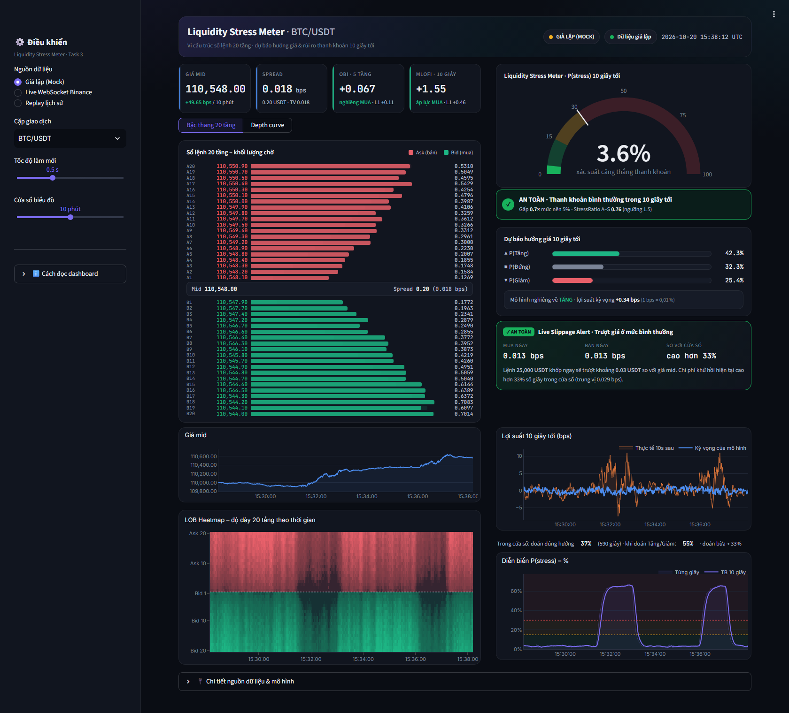
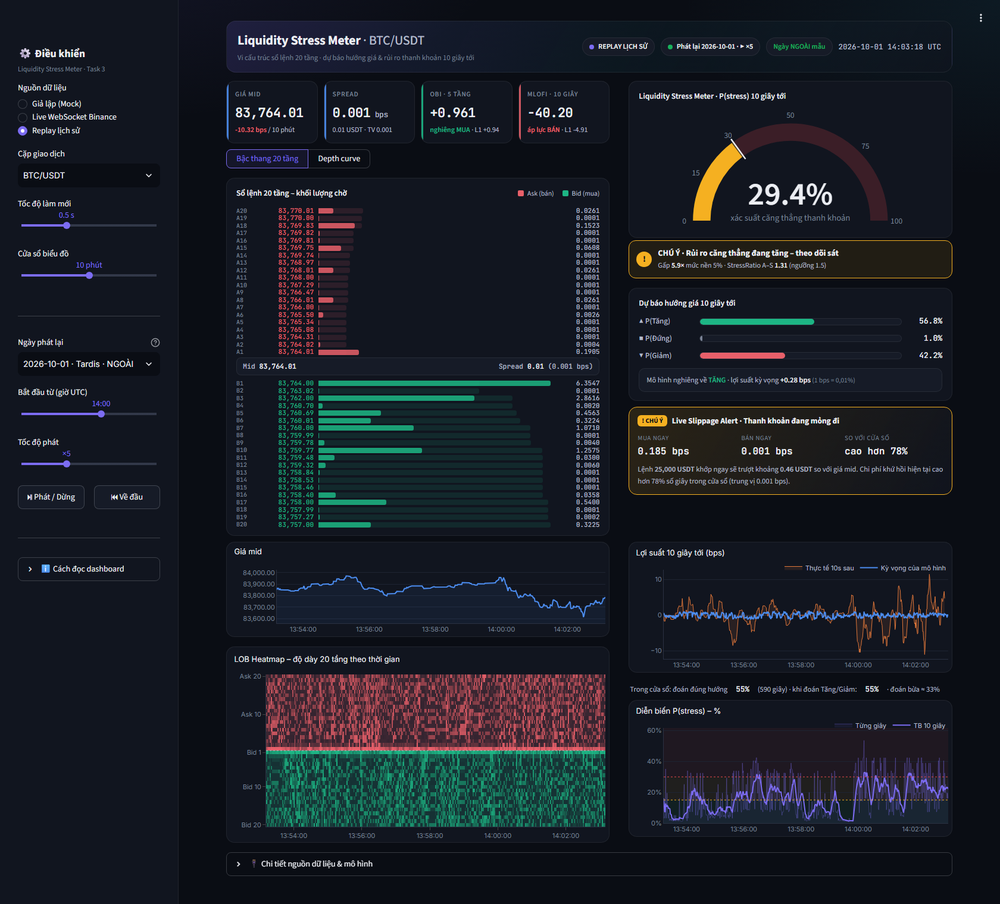
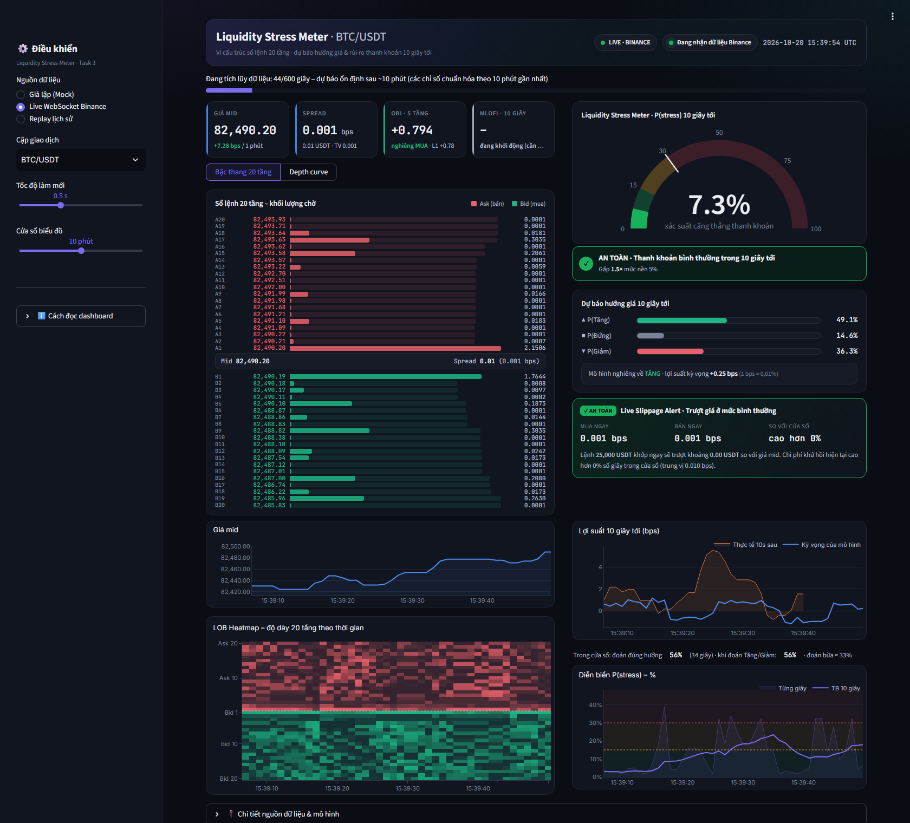

# BIÊN BẢN BÀN GIAO TASK 3 – STREAMLIT DASHBOARD "LIQUIDITY STRESS METER"

> Phạm vi: `src/task3_dashboard/` · Đầu vào: Task 1 (`BinanceLOBStreamer`, kho `data/raw/raw_lob_trades.parquet`) và Task 2 (`models/`, `ModelInference`, `calculate_all_features`).
> Phiên bản: 1.0 (2026-10-20) · Tự kiểm tra: **9/9 PASS** (`python -m src.task3_dashboard.selftest --live`).

---

## 1. Chạy như thế nào

| Cách | Lệnh |
|---|---|
| Bấm đúp | `src\task3_dashboard\CHAY_TASK3.bat` → trình duyệt tự mở `http://localhost:8501` |
| Lệnh theo đặc tả 4.4 | `streamlit run src/task3_dashboard/app.py` (chạy từ thư mục gốc dự án) |
| Mở thẳng 1 chế độ | `http://localhost:8501/?source=live` · `?source=replay` · `?source=mock` |
| Tự kiểm tra | `python -m src.task3_dashboard.selftest` (thêm `--live` để thử Binance thật) |

- Mở dashboard **không phải train lại**. Mô hình đã lưu trong `models/` và được nạp trong khoảng 1 giây.
- Tắt dashboard: đóng cửa sổ đen (hoặc nhấn Ctrl+C).
- Việc mở dashboard **không ảnh hưởng** đến lịch tự thu live (`Task1_ThuLiveKhiMoMay`) hay lịch cập nhật kho lúc 07:30. Chế độ Live mở một kết nối Binance riêng.

## 2. Ba nguồn dữ liệu (nút chuyển ở thanh bên – đặc tả 4.3)

| Nguồn | Dữ liệu sổ lệnh | Dự báo | Cần gì | Dùng khi |
|---|---|---|---|---|
| **Giả lập (Mock)** | `mock_streamer.py` sinh 20 tầng mỗi 100 ms | Xác suất **giả** | Không cần Task 1 / Task 2 | Thử giao diện, demo khi không có mạng |
| **Live WebSocket Binance** | `BinanceLOBStreamer` (Task 1), `depth20@100ms` + `trade` | Mô hình thật Task 2, tính mỗi 1 giây | Internet | Thuyết trình "thời gian thực" |
| **Replay lịch sử** | 1 ngày trong kho Task 1 (12 ngày Tardis + ngày tự thu) | Mô hình thật Task 2 | Kho Task 1 + `models/` | Xem lại một ngày, kể cả các đợt căng thẳng thật |

- **Replay**:
  - Chọn ngày, giờ bắt đầu (UTC) và tốc độ (×1, ×5, ×20, ×60), rồi bấm ⏯ / ⏮.
  - Ngày được ghi nhãn **NGOÀI mẫu** (2026-09-01, 2026-10-01 – tập test của Task 2) cho dự báo trung thực. Ngày **trong mẫu** là ngày mô hình đã học, chỉ dùng để minh họa; trên dashboard có pill cảnh báo.
  - Chỉ dùng dữ liệu đến thời điểm đang phát, không nhìn trước tương lai (selftest mục 7).
- **Live**:
  - 10 phút đầu có thanh "Đang tích lũy dữ liệu".
  - Các đặc trưng của Task 2 được chuẩn hóa theo 10 phút gần nhất, nên trong lúc này dự báo kém ổn định hơn. Đây là giới hạn của buffer 15 phút theo đặc tả Task 1, không phải lỗi.

## 3. Bố cục & các widget (đặc tả 4.3: 2 cột cân đối)


*Giả lập: lúc thị trường giả bình thường (xanh). Biểu đồ P(stress) bên dưới có 2 đợt căng thẳng giả trước đó (lên khoảng 60%, đồng hồ chuyển đỏ).*


*Replay 2026-10-01 (ngày ngoài mẫu) lúc 14:03 UTC: P(stress) 29% (vàng), chi phí mua 25k USDT cao hơn 78% số giây trong 10 phút qua.*


*Live Binance BTC/USDT trong lúc tích lũy dữ liệu 10 phút đầu.*

### Hướng dẫn sử dụng & cách đọc kết quả (thêm 2026-10-21)

- Đầu trang có 2 nút: **📊 Dashboard** và **📖 Hướng dẫn & cách đọc kết quả**. Mở thẳng trang hướng dẫn bằng `?page=guide`.
- Trang hướng dẫn (`components/guide.py`) có 4 phần:
  1. Dashboard dùng để làm gì.
  2. Hướng dẫn sử dụng: mở/tắt, thanh điều khiển, 3 chế độ, Replay.
  3. Cách đọc từng khu vực.
  4. Ý nghĩa của kết quả và tin được đến đâu: độ chính xác trên test, ý nghĩa kinh tế, giới hạn, ví dụ đọc 1 tình huống, từ ngữ hay gặp.
- Dưới **mỗi khối** của dashboard có 1 dòng **"Cách đọc"** ngắn. Tắt/bật bằng công tắc "Hiện chú thích dưới từng khối" ở thanh bên.
- Ô "ℹ️ Cách đọc dashboard" cũ ở thanh bên đã bỏ (quá hẹp, khó đọc).


### Thanh tiêu đề

- Cặp giao dịch, nguồn dữ liệu (MOCK / LIVE / REPLAY) và trạng thái kết nối. Chấm xanh nhấp nháy khi đang nhận dữ liệu.
- Pill trong / ngoài mẫu (chế độ Replay) và đồng hồ UTC.

### Cột trái – Vi cấu trúc sổ lệnh

| Widget | Nội dung | File |
|---|---|---|
| 4 thẻ chỉ số | **Giá mid** (thay đổi bps trong cửa sổ), **Spread** (bps, USDT, trung vị cửa sổ), **OBI 5 tầng** (+ tầng 1), **MLOFI 10 tầng / 10 giây** (+ OFI tầng 1). Màu viền: xanh = phía mua, đỏ = phía bán | `components/cards.py` |
| Bậc thang 20 tầng | Asks đỏ ở trên, Bids xanh ở dưới, giữa là dòng Mid và Spread. Thanh đậm = khối lượng từng tầng, nền nhạt = khối lượng cộng dồn. Nút chuyển sang **Depth curve** (đường cộng dồn, Plotly) | `components/depth_heatmap.py` |
| Giá mid | Đường giá trong cửa sổ 5, 10 hoặc 15 phút | `depth_heatmap.py` |
| **LOB Heatmap** | Trục ngang là thời gian, trục dọc là Ask 20 → Ask 1 \| Bid 1 → Bid 20. Màu càng đậm thì tầng đó càng nhiều lệnh chờ; vùng tối dần nghĩa là sổ lệnh mỏng đi | `depth_heatmap.py` (Plotly – đặc tả 4.3) |

### Cột phải – Dự báo & rủi ro thanh khoản

| Widget | Nội dung | File |
|---|---|---|
| **Liquidity Stress Meter** | Đồng hồ bán nguyệt 0–100%. **Xanh** < 15% · **Vàng** 15–30% · **Đỏ** > 30%. Vạch trắng là ngưỡng cảnh báo | `components/stress_meter.py` |
| Hộp mức rủi ro | Biểu tượng kèm chữ (AN TOÀN / CHÚ Ý / CẢNH BÁO), cho biết **gấp mấy lần mức nền 5%**, và StressRatio của Avellaneda–Stoikov (ngưỡng 1.5) | `stress_meter.py` |
| 3 thanh xác suất | P(Tăng) / P(Đứng) / P(Giảm) sau 10 giây, hướng mô hình nghiêng về, lợi suất kỳ vọng (bps) | `stress_meter.py` |
| **Live Slippage Alert** | Chi phí nếu **mua / bán ngay** một lệnh thị trường 25k USDT (BTC) hoặc 10k USDT (ETH) đi hết sổ 20 tầng, và chi phí hiện tại **cao hơn bao nhiêu % số giây** trong cửa sổ. Màu là mức cao hơn giữa mô hình và chi phí tức thời | `stress_meter.py` |
| Lợi suất 10 giây tới | Lợi suất **kỳ vọng của mô hình** so với lợi suất **thực tế** 10 giây sau (chỉ vẽ phần đã qua đủ 10 giây). Bên dưới là tỉ lệ đoán đúng hướng trong cửa sổ | `components/return_monitor.py` |
| Diễn biến P(stress) | Từng giây (nhạt) và trung bình 10 giây (đậm), có các dải ngưỡng 15% và 30% | `stress_meter.py` |
| **Dự báo spread 10 giây tới** *(thêm 21/10, nằm ở cột trái dưới sổ lệnh)* | Spread niêm yết hiện tại (tick) · P(spread giãn > 1 tick trong 10s) và gấp mấy lần mức nền · spread hiệu dụng dự báo (mua + bán ngay lệnh 25k/10k USDT) so với 10s qua | `components/spread_monitor.py` |
| **Đúng / sai từng giây** *(thêm 21/10)* | Mỗi giây 1 chấm xanh (đoán đúng hướng) / đỏ (sai), đường tỉ lệ đúng 1 phút, vạch đoán bừa 33%. **Biểu đồ lợi suất cũ giữ nguyên** | `return_monitor.hit_figure` |

Cột trái có thêm biểu đồ **Spread hiệu dụng 10 giây tới**: dự báo so với thực tế, kèm tam giác vàng ở những giây spread niêm yết thật sự > 1 tick (`spread_monitor.spread_figure`).

### Trang 🏆 So sánh mô hình *(thêm 21/10 – việc D)*

- 8 mô hình đoán hướng 10s **cùng lúc trên cùng luồng dữ liệu**: XGBoost (đang dùng), Random Forest, MNLogit, LogReg-OvR, DeepLOB, và 3 mốc so sánh CST, OBI-rule, Majority.
- Mô hình lấy từ `models/model_zoo.pkl` (Task 2 mục 7b). Điểm trên 2 ngày test **khớp báo cáo**.
- Mỗi giây mọi mô hình dự báo 1 lần. 10 giây sau có đáp án thì chấm. **Không nhìn trước:**
  - Live: dự báo của giây t chỉ làm đúng lúc t là hiện tại.
  - Replay: chỉ chấm các giây mà t + 10s ≤ con trỏ phát.
- Bảng xếp theo **tỉ lệ đoán đúng ± sai số** (số mẫu độc lập ≈ số giây / 10), kèm macro-F1 và tỉ lệ đúng khi dám đoán Tăng/Giảm. Màu:
  - xanh = ngang mô hình đứng đầu (chênh < sai số),
  - vàng = kém hơn rõ,
  - đỏ = không hơn đoán bừa (< 36%).
- Không xếp theo macro-F1: trong cửa sổ vài phút, lớp "Đứng" có thể gần như vắng mặt. Khi đó macro-F1 của **mọi** mô hình bị kéo về ~0,37 dù đúng 55% (thấy khi chụp Replay 01/10 lúc 14:00). Trên cả ngày, 3 lớp gần cân bằng nên tỉ lệ đúng ≈ macro-F1.
- Chọn cửa sổ chấm: 5 / 15 / 30 / 60 phút / toàn bộ. Có biểu đồ tỉ lệ đúng 5 phút theo thời gian của từng mô hình.
- Live giữ 2 giờ dự báo gần nhất. Replay chạy cả ngày 1 lần (~1–3 phút, có DeepLOB) rồi lưu `data/processed/task3_zoo/`.
- Giả lập (Mock) không có mô hình thật nên trang này chỉ hiện thông báo.


*Replay 2026-10-01 (ngoài mẫu), 15 phút đến 14:03 UTC: 7 mô hình đều 47–55%, chênh nhau nhỏ hơn sai số ±10%; Majority 4%.*


*Dashboard có thêm: khối Dự báo spread (cột trái), biểu đồ Spread hiệu dụng (cột trái), biểu đồ Đúng/sai từng giây (cột phải).*

## 4. Kết nối với Task 1 & Task 2 (Interface Contract)

```text
Live:    BinanceLOBStreamer.get_latest_data()  ──►  buffer_to_1s → build_base_features → add_structural_features
         (Task 1, buffer 15 phút, 100 ms)           (Task 2, mỗi 1 giây, luồng nền)
                                                ──►  ModelInference.predict_one(...)   (Task 2, đúng khóa đặc tả 3.6)
Replay:  data/raw/raw_lob_trades.parquet/<SYM>_<ngày>_<seed|rolling>.parquet + cache đặc trưng Task 2
                                                ──►  ModelInference.predict_frame(...) cho cả ngày (1 lần, ~10 giây)
Mock:    mock_streamer.MockStreamer             ──►  cùng cấu trúc dict của Task 1 + cùng khóa dự báo của Task 2
```

`data_sources.py` gom cả 3 nguồn về **một snapshot chuẩn**. Giao diện chỉ việc vẽ, không cần biết dữ liệu đến từ đâu:
`source, symbol, ts_ms, mid, bids, asks, hist (lưới 1 giây), pred (khóa của predict_one), status, in_sample`.

## 5. Hiệu năng (đặc tả 4.4: "không giật lag, cập nhật 100–500 ms")

| Hạng mục | Số đo |
|---|---|
| Chu kỳ làm mới thẻ chỉ số, sổ lệnh, đồng hồ, xác suất, cảnh báo | **0.5 s** (chỉnh được 0.25 / 0.5 / 1 / 2 s) |
| Chu kỳ vẽ lại biểu đồ lịch sử (mid, heatmap, lợi suất, P(stress)) | **2 s** |
| Lấy snapshot (Mock / Replay) | ~5 ms |
| Live: tính đặc trưng trên buffer 15 phút + dự báo | 80–250 ms + ~6 ms mỗi giây, ở **luồng nền** nên không chặn giao diện |
| Live: ping WebSocket / độ trễ sự kiện p50 | ~170 ms / ~70 ms (mạng gia đình tại VN, đo lúc selftest) |
| Replay: nạp 1 ngày và chạy mô hình cho 86.400 giây | ~10–13 s (chỉ lần đầu, sau đó dùng cache) |

## 6. Những điểm điều chỉnh so với đặc tả (và lý do)

| # | Đặc tả | Đã làm | Lý do |
|---|---|---|---|
| 6.1 | Bậc thang 20 tầng và đồng hồ vẽ bằng biểu đồ (gợi ý Plotly) | Vẽ bằng **HTML/SVG thuần**. Heatmap, depth curve và biểu đồ lịch sử vẫn dùng **Plotly** | Khi làm mới mỗi 0.5 s, biểu đồ Plotly trong Streamlit đôi lúc **trắng xóa trong tích tắc**: đo được khoảng 1/12 khung hình. HTML/SVG thì 0 khung hình bị trắng |
| 6.2 | Mọi thứ cập nhật 100–500 ms | 2 nhịp: phần số liệu 0.5 s, biểu đồ lịch sử 2 s. **Mô hình dự báo 1 lần/giây** | Mô hình Task 2 học trên lưới 1 giây, dự báo nhanh hơn không thêm thông tin. Biểu đồ 10 phút thay đổi rất ít trong 0.5 s mà mỗi lần vẽ lại tốn ~500 KB |
| 6.3 | Chỉ có Mock và Live | Thêm **Replay lịch sử** | Đề bài 4.2: "Có thể replay historical order book thay vì live trading". Đây cũng là cách duy nhất để xem dự báo trên các đợt căng thẳng **thật** của ngày test |
| 6.4 | Heatmap theo giá | Trục dọc theo **chỉ số tầng** (Ask 20 … Bid 20) | Với BTC, 20 tầng chỉ trải trong khoảng ±1 bps quanh mid. Theo giá tuyệt đối, sổ lệnh chỉ là một vệt mỏng trong khi giá trôi hàng chục USD |
| 6.5 | — | Độ dài thanh ở bậc thang theo **căn bậc hai** của khối lượng. Màu heatmap theo **log khối lượng** (kéo giãn giữa phân vị 5–99%) | Sổ lệnh thật rất lệch: 1 tầng có thể gấp hàng chục nghìn lần tầng khác. Thang tuyến tính làm các tầng nhỏ biến mất |
| 6.6 | "Hộp cảnh báo trượt giá tức thì" (chưa có định nghĩa) | Chi phí khớp ngay lệnh 25k / 10k USDT (cùng quy mô Task 2) **so theo phân vị trong cửa sổ** (đỏ ≥ 95%, vàng ≥ 80%), kết hợp mức của mô hình | Chi phí bình thường của BTC rất gần 0 bps, nên tỉ số "hiện tại / bình thường" nhảy lên hàng trăm lần. Phân vị 95% trùng cách Task 2 định nghĩa nhãn stress |
| 6.7 | — | Thêm **tỉ lệ đoán đúng hướng** trong cửa sổ và so với đoán bừa (33%) | Cho người xem thấy mô hình đang "đúng / sai" theo thời gian thực. Chỉ tính trên các giây đã qua đủ 10 giây |
| 6.8 | Ngưỡng màu đồng hồ | Live/Replay đọc từ `models/model_meta.json` qua `ModelInference` (0.30 / 0.15). Mock dùng `config.yaml` (cùng giá trị) | Ngưỡng 0.7 trong đặc tả gốc gần như không bao giờ đạt (xem Task 2 – mục 6, ngưỡng cảnh báo) |
| 6.9 | Cấu trúc thư mục 4.1 | Có đủ `app.py`, `mock_streamer.py`, `components/{depth_heatmap, stress_meter, return_monitor}.py`. Thêm `components/{cards, theme}.py`, `data_sources.py`, `lob_utils.py`, `config.yaml`, `selftest.py`, `CHAY_TASK3.bat`, `screenshots/` và `.streamlit/config.toml` ở thư mục gốc (giao diện tối) | Tách nguồn dữ liệu khỏi giao diện. `.streamlit/` phải nằm ở thư mục chạy lệnh thì Streamlit mới đọc được |
| 6.11 | Không có | Trang **Hướng dẫn & cách đọc kết quả** + dòng "Cách đọc" dưới từng khối (`components/guide.py`) | Người xem không chuyên cần biết mỗi con số nghĩa là gì và tin được đến đâu. Chọn trang bằng nút ở phía server thay cho `st.tabs`: lúc đang đọc hướng dẫn, dashboard không chạy làm mới ngầm |
| 6.12 | — | `selftest` mục 7 chỉ đối chiếu trên ngày **Tardis** ngoài mẫu | Từ 21/10/2026 kho có ngày tự thu (rolling). Cache đặc trưng Task 2 chỉ có ngày seed nên phép đối chiếu bị lỗi `KeyError`. Bản thân Replay ngày rolling vẫn chạy bình thường. Bổ sung 22/10: nếu **không có** cache đặc trưng (bản bàn giao `Thành phẩm/` không kèm ~0,7 GB cache), mục 7 tự tính đặc trưng từ kho Task 1, giống cách Replay làm |
| 6.13 | — | Thêm **dự báo spread** (khối số liệu + biểu đồ), biểu đồ **đúng/sai từng giây**, trang **🏆 So sánh mô hình** | Ảnh Roadmap của thầy có "Spread Forecast"; biểu đồ lợi suất cũ khó đọc nên thêm cách nhìn đúng/sai (không thay biểu đồ cũ); bảng xếp hạng trả lời "mô hình khác có tốt hơn khi chạy thật không" (việc D). `HIST_COLS` thêm `spr_ticks, p_spread_widen, eff_spread_fwd_bps`; thiếu `model_spread.pkl` thì các cột này NaN và khối spread hiện hướng dẫn chạy `CHAY_BO_SUNG.bat` |
| 6.10 | Mock = "fake probabilities" | Có thêm "chế độ thị trường" giả: cứ vài phút có 1 đợt căng thẳng (spread giãn, sổ mỏng, biến động mạnh), P(stress) giả **tăng trước ~20 s** | Để demo đủ 3 màu của đồng hồ và cảnh báo mà không cần chờ thị trường thật |

## 7. Tự kiểm tra (selftest)

```text
[PASS] 1. Cấu hình
[PASS] 2. Chi phí khớp lệnh impact_bps                      (so với số tính tay)
[PASS] 3. Mock đúng Interface Contract Task 1               (khóa dict, 20 tầng, giá bid giảm dần)
[PASS] 4. Mock đúng khóa dự báo Task 2
[PASS] 5. Lịch sử Mock đủ cột
[PASS] 6. Dựng mọi khối giao diện                            (không có 'nan' trong HTML)
[PASS] 7. Replay ngày ngoài mẫu                               (không nhìn trước; khớp predict_one < 1e-4)
[PASS] 8. Streamlit AppTest chạy 1 lượt
[PASS] 9. Bảng xếp hạng chấm đúng, không nhìn trước           (mô hình "biết trước" = 100%)
[PASS] 10. Bộ mô hình + dự báo spread trên Replay              (cột XGBoost khớp dashboard > 99,9%)
[PASS] 11. Live WebSocket Binance                             (--live, có cả bảng xếp hạng)
11/11 mục đạt   (21/10/2026)
```

## 8. Checklist so với đặc tả Phần 4

- [x] `streamlit run src/task3_dashboard/app.py` chạy được
- [x] Bố cục 2 cột: trái = vi cấu trúc, phải = dự báo & rủi ro
- [x] Thẻ Mid, Spread, OBI (thêm OFI/MLOFI theo đề bài 4.2: "Depth imbalance, OFI")
- [x] Thanh ngang 20 tầng Bids xanh / Asks đỏ
- [x] LOB Heatmap (Plotly) theo thời gian
- [x] Đồng hồ Liquidity Stress Meter 0–100%, đổi màu Xanh / Vàng / Đỏ khi vượt ngưỡng
- [x] 3 thanh P(Up) / P(Flat) / P(Down)
- [x] Hộp cảnh báo trượt giá tức thì (Live Slippage Alert)
- [x] Biểu đồ diễn biến lợi suất ngắn hạn
- [x] `mock_streamer.py` chạy độc lập 100%
- [x] Nút chuyển nguồn Mock / Live (thêm Replay)
- [x] Cập nhật 0.5 s, không nhấp nháy ở phần số liệu
- [x] README kèm ảnh chụp widget và hướng dẫn thao tác
- [x] Hướng dẫn sử dụng & cách đọc kết quả ngay trong dashboard (trang riêng + chú thích dưới từng khối)
- [x] (Bổ sung) Dự báo spread 10s tới · biểu đồ đúng/sai từng giây · bảng xếp hạng 8 mô hình chạy live/replay
